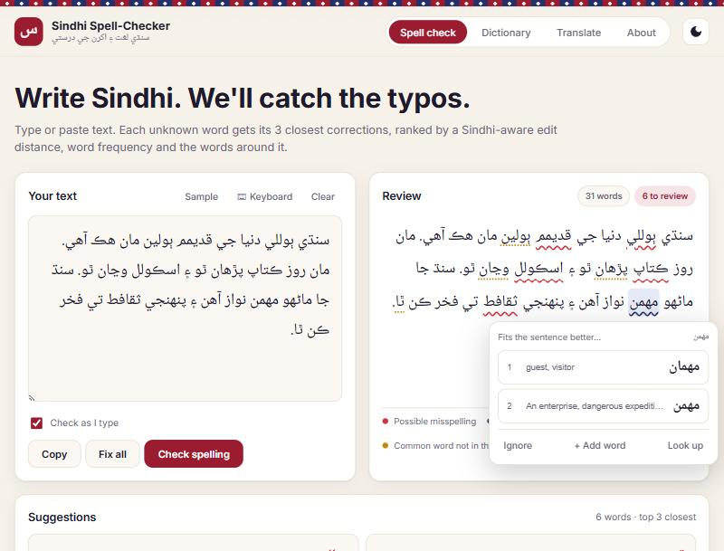

# Sindhi Spell-Checker, Dictionary & Translator

**Made by Sneha Haseja and Javeria Jatoi.**

A Sindhi NLP toolkit with a web front end:

- **Spell checking** for Sindhi's Perso-Arabic script. Every unknown word gets its
  **3 closest corrections**, ranked by a Sindhi-aware edit distance, word frequency from
  53 million tokens of real Sindhi text, and a bigram model of the surrounding words.
  Correctly spelled words that don't fit the sentence (`مهمن نواز` → `مهمان نواز`) are flagged too.
- **Dictionary**: 58k Sindhi headwords with English glosses and Sindhi definitions, English → Sindhi
  search, autocomplete, inflected-form lookup (`ڪتابن` → `ڪتاب`), word of the day.
- **Sentence translation** Sindhi ↔ English with Meta's NLLB-200, running **offline on a CPU**.

Started as a 15-day university prototype (weighted edit distance + dictionary lookup) and
extended in three phases. See [`docs/results.md`](docs/results.md) for the numbers.



## Quick start

**Windows:** double-click `setup.bat` once, then `run.bat`. **macOS/Linux:** `./setup.sh`, then `./run.sh`.
Step-by-step instructions for a new laptop are in [`SETUP.md`](SETUP.md).

Or by hand:

```bash
git clone https://github.com/snehahaseja-code/Sindhi---English-Translator-and-Spell-Checker.git
cd Sindhi---English-Translator-and-Spell-Checker
python -m venv .venv
.venv\Scripts\activate            # macOS/Linux: source .venv/bin/activate
pip install -r requirements.txt
python scripts/download_models.py # offline translator, ~630 MB (optional)
python -m uvicorn src.api:app --port 8000
```

Open <http://localhost:8000>. The first start takes ~20 s to build the SymSpell index,
which is then cached in `data/cache/`. Without the translator model the Translate tab falls back to
word-by-word dictionary glosses.

Other entry points:

```bash
pytest                          # tests
python main.py "سنڌى ٻولي"       # CLI spell check (or: python main.py --file input.txt)
streamlit run src/app.py        # the original simple Streamlit UI
python scripts/evaluate.py      # spelling accuracy on the held-out test split
```

## How it works

| Step | What happens | Code |
|---|---|---|
| Normalize | NFC, presentation forms → letters, Arabic/Urdu/Persian keyboard look-alikes folded (ى ی → ي, ك → ڪ, ہ → ه, ھ ≈ ه), tatweel and vowel marks ignored for lookup | `src/normalization.py` |
| Tokenize | Arabic-script word runs with character offsets; multi-word headwords (`اک ڇنڀ`) matched as phrases | `src/tokenizer.py`, `src/spellchecker.py` |
| Detect | Known if in the lexicon, seen ≥ 5 times in the corpus (covers inflections the lexicon lacks), or in your word list | `src/dictionary.py` |
| Generate | SymSpell: every word within 2 edits in ~1 ms | `src/candidate_generator.py` |
| Score | Weighted Damerau-Levenshtein. Letters that differ only by dots (ب ٻ ڀ پ ت ٿ ٽ ٺ) or sound alike (س ص ث, ز ذ ض ظ) cost less, and so do dropped or added weak letters (ا و ي) | `src/edit_distance.py`, `src/sindhi_cost_model.py` |
| Rank | `0.8·distance − 0.2·log-frequency + 0.2·context`, weights tuned on a dev split; top 3 shown | `src/ranking.py`, `src/context_model.py` |
| Real-word errors | A known word is flagged when a near-identical word fits its neighbours far better | `SpellChecker.real_word_check` |
| Translate | NLLB-200 distilled 600M, CTranslate2 int8, CPU | `src/translator.py` |

## Project layout

```
src/            spell checker, dictionary, translator, FastAPI backend (api.py), Streamlit UI (app.py)
web/            front end (plain HTML/CSS/JS, served by src/api.py)
scripts/        data building, evaluation, tuning, downloads
kaggle/         optional GPU notebooks (not run; see Future work)
data/           lexicon (dictionary.json), corpus stats, test sets
docs/           results, dataset sources, cost-model notes
```

## Rebuilding the data

```bash
python scripts/download_lexicon.py && python scripts/build_dictionary_json.py   # lexicon
python scripts/download_models.py --corpus                                      # Wikipedia + CC-100
python scripts/build_corpus_stats.py        # data/frequencies.tsv, data/bigrams.tsv.gz
python scripts/build_extra_translations.py  # Wiktionary glosses
python scripts/make_test_set.py             # data/test_words.json, data/test_context.json
python scripts/tune.py                      # grid search on the dev split
python scripts/evaluate.py --save           # test split → docs/results.json (shown in the app)
python scripts/download_models.py --flores && python scripts/eval_translation.py
```

## Future work (optional GPU notebooks)

Everything above runs on a CPU, and all reported numbers come from CPU runs. The `kaggle/` folder
holds three notebooks that were written but **not run** for this submission. They are ideas for
a free Kaggle T4 GPU:

1. `01_nllb_eval_and_export.ipynb`: compare the larger NLLB 1.3B model and export it for this app.
2. `02_nllb_lora_finetune.ipynb`: LoRA fine-tune NLLB on OPUS-100 en–sd.
3. `03_xlmr_context_rerank.ipynb`: test XLM-RoBERTa as a stronger suggestion re-ranker
   (input from `scripts/export_rerank_input.py`).

## Limitations

- The spelling evaluation uses **synthetic** errors (seeded, reproducible, 7 error types). Real
  typos from real users would be a better test.
- Many English glosses come from Mewaram's 19th-century dictionary. Wiktionary glosses (1.3k
  words) are shown first where available.
- "Known because common in the corpus" can accept a misspelling that is itself common on the web.
- NLLB-200 is CC BY-NC 4.0: fine for this project, but not for commercial use.

## Data sources & attribution

Dictionary data comes from the **Sindhi Open Lexicon** dataset
(SindhiLanguage.org, prepared and curated by Amar Fayaz Buriro, امر فياض ٻرڙو, CC BY 4.0).
**Keep that attribution anywhere this project or its output is shown or submitted.**

Also used: Sindhi Wikipedia (CC BY-SA 4.0), CC-100 Sindhi, Wiktionary via kaikki.org
(CC BY-SA 4.0), FLORES-200 (CC BY-SA 4.0), and NLLB-200 (Meta AI, CC BY-NC 4.0). Full details are in
[`docs/dataset_sources.md`](docs/dataset_sources.md).
